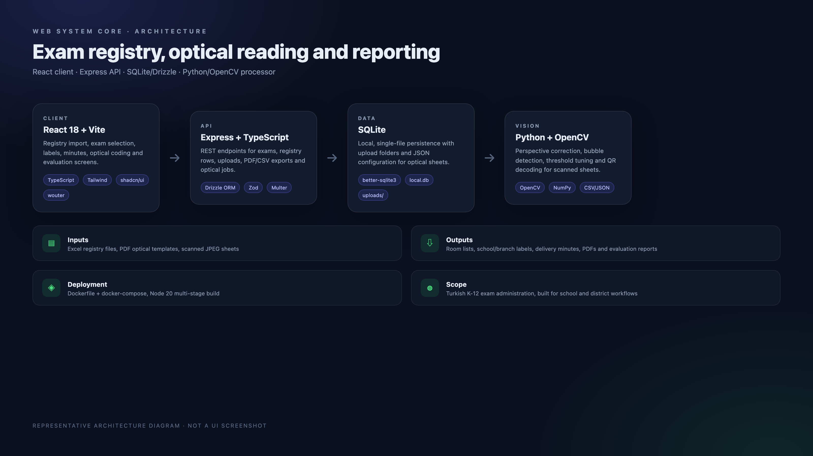

# Web System Core

> Exam registry management, optical coding/reading, labels, delivery minutes and student evaluation in one self-hosted web app.

[](https://react.dev/)
[](https://www.typescriptlang.org/)
[](https://expressjs.com/)
[](https://orm.drizzle.team/)
[](https://www.docker.com/)
[](LICENSE)

<p align="center">
  <a href="https://www.buymeacoffee.com/cmtrkr"></a>
</p>

Web System Core is a Turkish-language administration suite for school and district exam workflows. It imports registry spreadsheets, splits them by district/school/branch, prints room lists, school and branch labels, delivery minutes, and supports optical form coding and reading from scanned sheets.

It is a single deployable app: React/Vite client, Express/TypeScript API, SQLite with Drizzle ORM, and an optional Python/OpenCV processor for optical reading.

## 📸 Architecture

<p align="center">
  
  <br>
  <sub>Representative architecture diagram — not a UI screenshot.</sub>
</p>

## ✨ Modules

### Exam management
- Create, select and delete exams.
- Each exam gets a unique `sinavid` (`#XXXXXX`).
- Last selected exam is remembered in `localStorage`.

### Registry import
- **Template registry** — structured Excel files with automatic column detection for district, school and student data.
- **Free Excel** — flexible column mapping; only student name/surname is required.
- Optional special-education filtering.

### Reports and printing
- **Registry split** — district/school/branch/student distribution as a table or PDF; batch PDF download and HTML print.
- **Room lists** — filtered by district/school, exported with jsPDF.
- **School and branch labels** — color schemes (blue, orange, green, gray, yellow, colorless), configurable grid, optional course name, HTML print.
- **Delivery minutes** — district-level and school-level delivery lists, blank templates, multi-page PDF via html2canvas + jsPDF.

### Optical forms
- **Optical coding** — upload a PDF template, drag fields (student name, school, TC no, etc.) onto the sheet, A4/A5 support, print.
- **Optical reading** — JPEG scans, black-frame detection, perspective correction, bubble fill detection, batch processing, adjustable threshold, QR decoding, CSV/JSON export.
- **Evaluation** — upload answer CSVs, compare with the answer key, view correct/wrong/blank statistics.

### UX
- Responsive layout with Tailwind CSS, shadcn/ui and Radix UI.
- Toast feedback for every operation.
- Local-first data; no cloud dependency.

## 🛠️ Tech stack

| Layer | Technology |
| --- | --- |
| Frontend | React 18, Vite, TypeScript, Tailwind, shadcn/ui, Radix UI, wouter |
| Backend | Node.js, Express, TypeScript |
| Database | SQLite (`better-sqlite3`) + Drizzle ORM |
| PDF | jsPDF, html2canvas |
| Excel | SheetJS (`xlsx`) |
| Vision | Python, OpenCV, NumPy |
| State | React Context |
| Deploy | Docker multi-stage, docker-compose, Portainer stack |

## 📁 Project structure

```text
├── client/
│   └── src/
│       ├── components/      # UI, layout, optical editor
│       ├── context/         # RegistryContext
│       ├── hooks/
│       ├── lib/
│       └── pages/           # exam selection, dashboard, registry split, labels,
│                            # room lists, reports, optical coding/reading, evaluation
├── server/
│   ├── index.ts             # Server entry
│   ├── routes.ts            # API routes
│   ├── storage.ts           # Database operations
│   ├── static.ts            # Static serving
│   ├── vite.ts              # Vite integration
│   └── optical_processor.py # OpenCV pipeline
├── shared/schema.ts         # Shared types and Drizzle schema
├── db/                      # SQLite database and optical configs/uploads
├── Dockerfile
├── docker-compose.yml
└── portainer-stack.yml
```

## 🚀 Local setup

Requirements: Node.js 20+, npm, Python 3.9+ (only for optical reading).

```bash
npm install
npm run dev
# http://localhost:5050
```

Production build:

```bash
npm run build
npm start
```

### Database

- Main SQLite file: `./db/local.db`
- Tables: `exams`, `registry_districts`, `registry_schools`, `registry_students`, `registry_meta`
- Optical results: `optic_readings.sqlite` (`optic_scan_sessions`, `optic_scan_answers`)
- Schema update: `npm run db:push`

## 🐳 Docker / Portainer

```bash
docker compose up --build -d
docker compose logs -f
docker compose down
```

The app listens on port **5050** inside the container. Change the host port with `APP_PORT`:

```bash
APP_PORT=8080 docker compose up --build -d
```

The `db/` folder is mounted as a volume, so data survives container restarts.

**Portainer (recommended):** Stacks → Add stack → Repository → select this repo and `portainer-stack.yml`. For an image-based deploy, push `cmtrkr83/web-system-core:latest` to a registry first and use the same stack file.

## 🔌 API overview

| Method | Route | Description |
| --- | --- | --- |
| `GET` | `/api/exams` | List exams |
| `POST` | `/api/exams` | Create an exam |
| `PUT` | `/api/exams/:id/activate` | Activate an exam |
| `DELETE` | `/api/exams/:id` | Delete an exam and related data |
| `GET` | `/api/registry` | Get registry data |
| `POST` | `/api/registry/replace` | Replace registry data |
| `POST` | `/api/registry/clear` | Clear registry data |
| `GET` | `/api/optics/configs` | List optical configurations |
| `POST` | `/api/optics/configs` | Save an optical configuration |
| `GET` | `/api/optics/results` | List optical results |
| `POST` | `/api/optics/results` | Save optical results |
| `POST` | `/api/optics/scans` | Save a scan session |
| `GET` | `/api/optics/scans` | List scan sessions |
| `POST` | `/api/optics/process` | Run image processing |
| `POST` | `/api/optics/detect-frame` | Detect a form frame |
| `POST` | `/api/optics/upload` | Upload a scan |
| `POST` | `/api/optics/batch` | Batch process scans |

## 🔐 Security and data notes

- The app is designed for a trusted school network. Put it behind a reverse proxy with authentication before exposing it publicly.
- Registry and exam data include student information. Take regular backups of `db/`, restrict filesystem access, and follow your institution's data-protection rules.
- The repository uses a local `.env` for `HOST` and `DATABASE_URL` only. Do not add SMTP passwords, API keys or other secrets to it; use environment variables in your deployment platform.
- Optical uploads may contain personal data; clean `db/optic_uploads/` when no longer needed.
- The generated PDFs and labels are only as accurate as the imported Excel data — verify a sample before bulk printing.
- This is an independent project, not an official Ministry of National Education product.

## ❤️ Support

If this suite saves your institution time, you can buy me a coffee:

<p align="center">
  <a href="https://www.buymeacoffee.com/cmtrkr"></a>
</p>

## 📄 License

[MIT](LICENSE) © 2026 Cem Türker.
